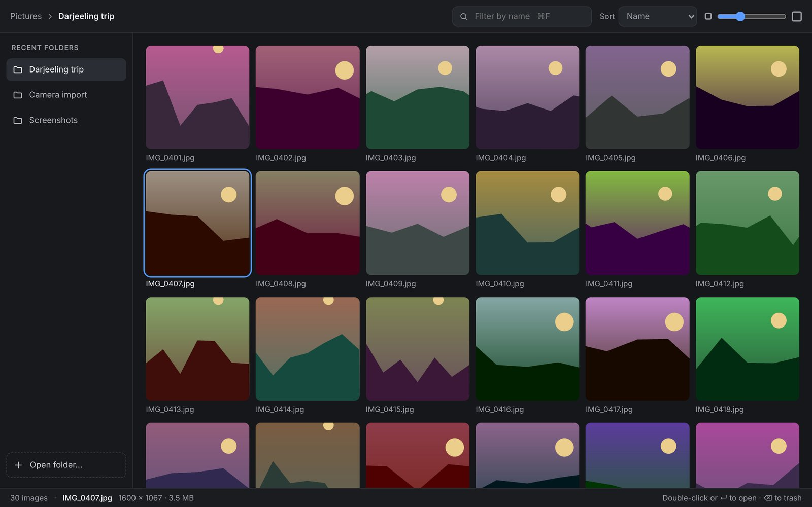
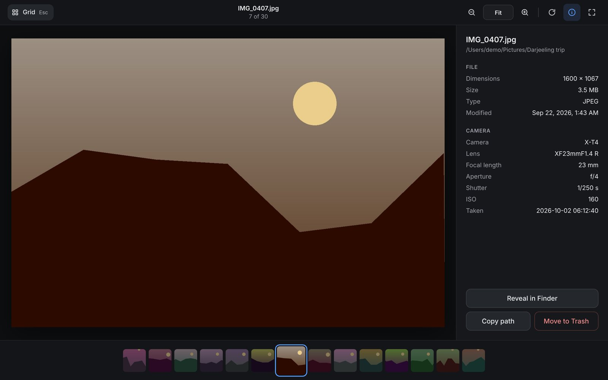
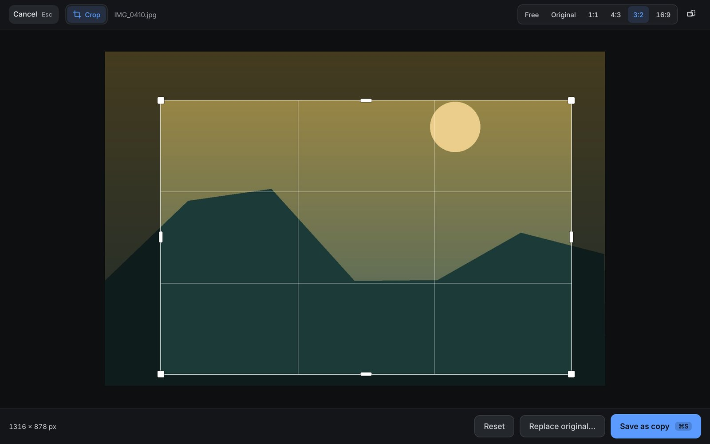

<p align="center">
  
</p>

<h1 align="center">Spektro Photo</h1>

<p align="center">
  A fast, simple desktop image viewer built with <a href="https://tauri.app">Tauri 2</a>, Rust and React.
</p>

<p align="center">
  <a href="../../releases/latest"><b>Download the latest release</b></a>
  &nbsp;·&nbsp; Current version: 0.1.2 &nbsp;·&nbsp;
  <a href="CHANGELOG.md">Changelog</a>
</p>





## What's new in 0.1.2

**Adjust colours.** Press <kbd>A</kbd> in the grid or viewer, or click the adjust button, to open the editor on the new Adjust panel.

- Sliders for **temperature**, **brightness**, **contrast** and **saturation**, from −100 to +100.
- A live preview that matches the saved file. It stays on while you crop, so a crop and an adjustment are saved together in one file.
- <kbd>Tab</kbd> between sliders and use the arrow keys to change one (<kbd>Shift</kbd> for steps of 10). Double-click a slider to reset it, or use **Reset all**.
- Switch between Crop and Adjust inside the editor with <kbd>C</kbd> and <kbd>A</kbd>.
- As with crop: **Save as copy** or **Replace original** (the original goes to the Trash), and camera data and colour profiles are kept.

The crop editor arrived in 0.1.1:



The full list of changes is in the [changelog](CHANGELOG.md).

## Features

- **Open a folder, an image, or drop either onto the window.** Recent folders are one click away; remove one from the list with its × (the folder itself isn't touched).
- **Thumbnail grid** with an adjustable tile size, filtering by name, and sorting by name, date or size. Thumbnails are generated in Rust and cached on disk, so large camera folders stay responsive.
- **Viewer** with zoom toward the cursor, drag to pan, fit / 100%, view-only rotation, a navigator mini-map when zoomed in, and a filmstrip of nearby images.
- **Info panel** with dimensions, file details and camera EXIF (camera, lens, focal length, aperture, shutter, ISO, date taken).
- **Crop** with a draggable box, aspect presets (free, original, 1:1, 4:3, 3:2, 16:9, portrait or landscape), and keyboard nudging. Save the result as a new copy or replace the original. Camera data (EXIF) and colour profiles are kept, and a replaced original goes to the Trash.
- **Adjust** temperature, brightness, contrast and saturation with sliders and a live preview that matches the saved file. Combine it with a crop in one save.
- **Safe delete:** Move to Trash with a 5-second Undo. Files are never deleted permanently.
- **Keyboard-first:** everything has a shortcut (press <kbd>?</kbd> in the app).
- Remembers window size, thumbnail size, sort order and recent folders.

Supported formats: JPEG, PNG, GIF, WebP, BMP, and on macOS HEIC / HEIF (iPhone photos). Edits to a HEIC photo are saved as a JPEG copy.

## Download

Get the installer from the [Releases page](../../releases/latest).

| Platform | File | Notes |
|---|---|---|
| macOS (Apple Silicon, M1 or later) | `…_aarch64.dmg` | Signed and notarized. Open the `.dmg` and drag Spektro Photo to Applications. |
| Windows 10 / 11 | `…_x64-setup.exe` or `.msi` | Not code-signed yet. If SmartScreen appears, click **More info → Run anyway**. |

Intel Macs aren't supported at the moment.

## Keyboard shortcuts

| Key | In the grid | In the viewer |
|---|---|---|
| <kbd>←</kbd> <kbd>→</kbd> <kbd>↑</kbd> <kbd>↓</kbd> | Move selection | Previous / next image |
| <kbd>↵</kbd> / <kbd>Space</kbd> | Open in viewer | Next image |
| <kbd>Esc</kbd> | Clear filter | Back to grid (or leave full screen) |
| <kbd>+</kbd> / <kbd>−</kbd> | Thumbnail size | Zoom in / out |
| <kbd>0</kbd> / <kbd>1</kbd> | | Fit / 100% |
| <kbd>C</kbd> | Crop | Crop |
| <kbd>A</kbd> | Adjust colours | Adjust colours |
| <kbd>R</kbd> | | Rotate (view only) |
| <kbd>I</kbd> | | Toggle info panel |
| <kbd>F</kbd> | | Full screen |
| <kbd>⌫</kbd> | Move to Trash | Move to Trash |
| <kbd>Tab</kbd>, <kbd>⌫</kbd> | Remove a recent folder from the list | |
| <kbd>⌘</kbd><kbd>Z</kbd> | Undo trash | Undo trash |
| <kbd>⌘</kbd><kbd>F</kbd> | Filter by name | |
| <kbd>⌘</kbd><kbd>O</kbd> | Open folder | Open folder |
| <kbd>?</kbd> | Show shortcuts | Show shortcuts |

In the editor: <kbd>C</kbd> / <kbd>A</kbd> switch between Crop and Adjust, <kbd>⌘</kbd><kbd>S</kbd> saves as a copy, <kbd>Esc</kbd> cancels.
- **Crop:** drag the box or its handles (drag outside it to draw a new one), <kbd>←</kbd> <kbd>→</kbd> <kbd>↑</kbd> <kbd>↓</kbd> to nudge it (<kbd>Shift</kbd> for 10 px).
- **Adjust:** <kbd>Tab</kbd> between sliders, <kbd>←</kbd> <kbd>→</kbd> to change one (<kbd>Shift</kbd> for 10), double-click a slider to reset it.

On Windows, use <kbd>Ctrl</kbd> instead of <kbd>⌘</kbd>.

## Development

### Prerequisites

- [Rust](https://rustup.rs) (stable)
- [Node.js](https://nodejs.org) LTS
- Platform tools from Tauri's [prerequisites guide](https://v2.tauri.app/start/prerequisites/): Xcode Command Line Tools on macOS; Microsoft C++ Build Tools and WebView2 on Windows

### Run

```bash
npm ci
npm run tauri dev
```

The first run compiles all Rust dependencies, which takes a few minutes. After that, frontend changes hot-reload and Rust changes trigger a quick rebuild.

### Test

```bash
cd src-tauri && cargo test
```

The Rust tests cover cropping, colour adjustments, EXIF rotation, keeping metadata, file naming, and the copy / replace save paths.

### Build

```bash
npx tsc               # type-check first; the build fails on unused imports
npm run tauri build
```

The installers are written to `src-tauri/target/release/bundle/` (`macos/` and `dmg/` on macOS; `msi/` and `nsis/` on Windows).

To sign and notarize a macOS build locally, set these environment variables before building (keep them in a file outside the repository and `source` it):

```bash
export APPLE_SIGNING_IDENTITY="Developer ID Application: Your Name (TEAMID)"
export APPLE_ID="you@example.com"
export APPLE_PASSWORD="app-specific-password"
export APPLE_TEAM_ID="TEAMID"
```

Then check the result with `spctl -a -vvv "src-tauri/target/release/bundle/macos/Spektro Photo.app"`. It should report `source=Notarized Developer ID`.

## How it works

```
React (webview)                                Rust (src-tauri)
───────────────                                ────────────────
invoke("open_path")      ── IPC ──▶  library.rs   scan folder, grant access
    ───────▶  Tauri asset protocol: full-size image
    ───────▶  thumbs.rs    decode → resize → disk cache
  ───────▶  thumbs.rs    HEIC: decode (heic/) → full-size JPEG → disk cache
invoke("image_info")     ── IPC ──▶  info.rs      dimensions + EXIF
invoke("trash_image")    ── IPC ──▶  library.rs   move to OS Trash
invoke("apply_edits")    ── IPC ──▶  edit/        load → crop → adjust → save copy / replace
```

- **Images never go through IPC.** Full-size images load through Tauri's asset protocol, and thumbnails through a custom `thumb://` protocol, so the webview streams and decodes them natively.
- **Access is granted per folder.** The asset protocol's scope starts empty. Opening a folder adds it at runtime, and `thumb://` and every command check the same list (`AppState`), so the webview can only read folders the user opened.
- **HEIC (macOS only)** is decoded in Rust with Apple's ImageIO framework (`heic/`, through the `objc2` bindings), the decoder Preview and Photos use, so nothing extra is bundled. The webview can't be relied on to show HEIC, so the viewer and editor get a full-size JPEG with the colour profile kept, from a `preview://` protocol that works like `thumb://`. Thumbnails, the info panel and editing use the same decoder; since HEIC can't be written back, edits are saved as `name (edited).jpg` and *Replace original* is off for HEIC. On Windows, HEIC files aren't listed.
- **Thumbnails** are decoded with the `image` crate, rotated according to EXIF orientation, resized to 560 px, and cached under the app's cache directory, keyed by path, size and modified time. A semaphore limits how many are decoded at once.
- **Undo for Trash** works by waiting: the file disappears from the list immediately, and is only moved to the Trash after the 5-second Undo window closes.
- **Editing** happens in Rust. The frontend only describes the edit as a list of operations, e.g. `[{ "type": "crop", "x": 120, "y": 80, "width": 1600, "height": 900 }]`, in the image's displayed pixel coordinates. Rust loads the original with its EXIF rotation applied, runs the operations, and re-encodes in the same format (JPEG at quality 92), keeping the colour profile and EXIF. The orientation flag is reset, because the pixels are already rotated. It always writes to a temporary file first. *Save as copy* then renames it to `name (edited).jpg`; *Replace* moves the original to the Trash and renames the temporary file into its place. Animated GIFs can't be edited, since saving would drop their frames.
- **Colour adjustments** are each a small 3×4 *colour matrix* (scale and mix the R, G, B values, plus an offset). The matrices for temperature, brightness, contrast and saturation are multiplied into one, so Rust processes the image in a single pass (`edit/color.rs`, `edit/adjust.rs`). The frontend builds the same matrix (`src/edit/colorMatrix.ts`, `tools/adjust/adjustments.ts`) and draws the image through an SVG `<feColorMatrix>` filter, so the preview is instant and matches the saved pixels. A Rust test pins the numbers both sides must agree on.
- **Cache busting:** after a replace, the path is unchanged, so image URLs carry `?v=<modified>-<size>` to make the webview load the new pixels.

### Adding an edit tool

Edits are built as a pipeline, so a new tool (rotate, resize, brightness…) doesn't touch the editor itself:

1. **Rust:** add `src-tauri/src/edit/<tool>.rs` with a struct for its parameters and `impl Operation for <Tool>`, then add a variant to the `EditOp` enum in `edit/mod.rs` and its arm in `EditOp::operation`.
2. **TypeScript:** add the operation's type to `EditOp` in `src/edit/types.ts`.
3. **UI:** create `src/edit/tools/<tool>/` exporting `defineTool({ id, label, shortcut, icon, init, isNoop, toOps, Controls?, Overlay?, Panel?, colorMatrix? })`, and add it to `src/edit/tools/index.ts`.

The editor then shows the tool's tab, toolbar controls, overlay and side panel, and includes its operations when saving. Tools run in registry order, so put geometry tools (crop, rotate) before tools that change pixel values.

A tool that changes colours can return a `colorMatrix` for an instant preview, applied whichever tool is active. To add another slider to Adjust (e.g. tint), add an entry to `ADJUSTMENTS` in `tools/adjust/adjustments.ts`, and a field, a matrix function and a line in `Adjust::matrix` in `edit/adjust.rs`.

### Project layout

```
src/                     React frontend
├─ App.tsx               app state, keyboard handling, open / trash / edit flow
├─ components/           Welcome, Library (grid), Viewer, InfoPanel, overlays, icons
├─ edit/                 editor
│  ├─ EditMode.tsx       editor shell: layout, tool tabs, save / replace
│  ├─ tool.ts            the EditTool interface every tool implements
│  ├─ types.ts           operation types shared with Rust
│  ├─ colorMatrix.ts     colour matrices for the live preview (mirrors color.rs)
│  └─ tools/
│     ├─ crop/           crop tool: state, box overlay, aspect controls, geometry
│     └─ adjust/         adjust tool: slider list + formulas, side panel
└─ lib/                  typed command wrappers (api.ts), preferences, hooks
src-tauri/
├─ src/
│  ├─ lib.rs             app setup: plugins, state, protocol, commands
│  ├─ library.rs         open_path, trash_image, folder scanning
│  ├─ thumbs.rs          thumb:// and preview:// protocols, disk cache
│  ├─ imaging.rs         shared loader: EXIF rotation, colour profile, EXIF
│  ├─ heic/              HEIC / HEIF: mod.rs (shared), imageio.rs (macOS decoder)
│  ├─ edit/              apply_edits: EditOp pipeline (mod.rs), crop.rs, adjust.rs + color.rs, output.rs (safe saving)
│  ├─ info.rs            image_info (dimensions, EXIF)
│  ├─ state.rs           allowed folders + thumbnail semaphore
│  └─ error.rs           AppError, serialized to the frontend
├─ capabilities/         frontend permissions
└─ tauri.conf.json       window, bundle and security config
.github/workflows/       release workflow
```

## Releasing

Releases are built by GitHub Actions (`.github/workflows/release.yml`) for macOS and Windows.

1. On `dev`, bump `version` in `src-tauri/tauri.conf.json`, `package.json` and `src-tauri/Cargo.toml` (and commit the updated `Cargo.lock`). Update `CHANGELOG.md` and this README.
2. Merge `dev` into `main` with a pull request.
3. Tag the merged commit on `main` and push only that tag. The workflow checks that the tag matches `tauri.conf.json`:
   ```bash
   git checkout main
   git pull origin main
   git tag -a v0.2.0 -m "Spektro Photo 0.2.0"
   git push origin v0.2.0
   ```
4. The workflow builds, signs and notarizes the macOS app, builds the Windows installers, and uploads everything to a **draft** release. Review it, then publish.

The workflow needs these repository secrets for macOS signing: `APPLE_CERTIFICATE`, `APPLE_CERTIFICATE_PASSWORD`, `APPLE_SIGNING_IDENTITY`, `APPLE_ID`, `APPLE_PASSWORD`, `APPLE_TEAM_ID`. It also needs **Settings → Actions → General → Workflow permissions** set to **Read and write**.

## Roadmap

- [ ] Watch the open folder and update the grid live (`notify` crate)
- [ ] Remember folder access across restarts, so recents show cover photos
- [ ] Code-sign the Windows installer
- [x] Brightness, contrast, saturation and temperature
- [ ] More edit tools: rotate / flip, resize
- [x] HEIC / HEIF on macOS
- [ ] Camera RAW support (Apple's ImageIO, used for HEIC, can also decode most RAW files on macOS)

## License

Released under the [MIT License](LICENSE). Copyright © 2026 Avirup Basu.
