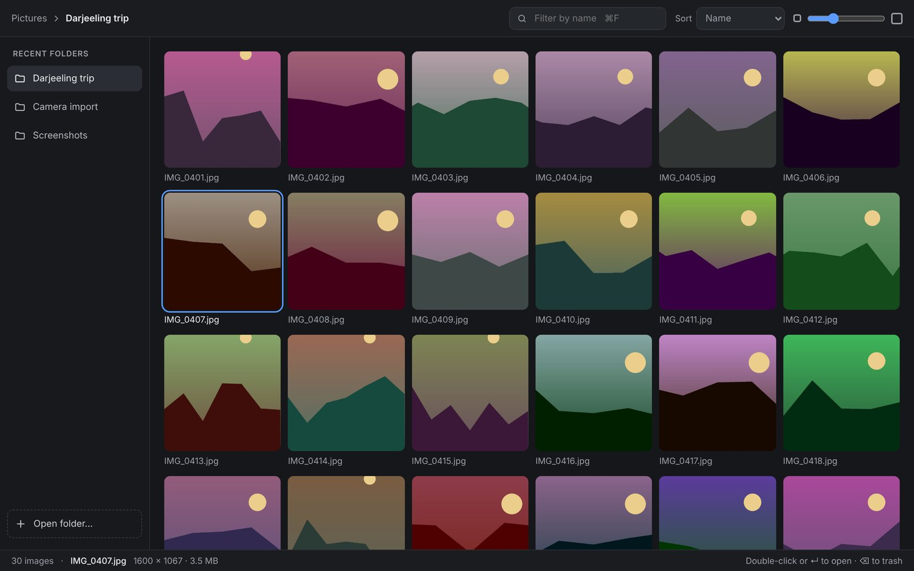
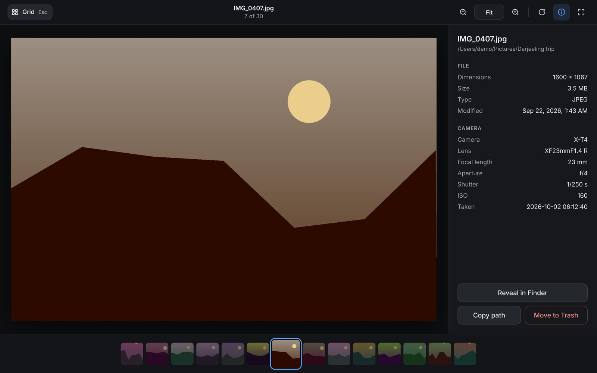
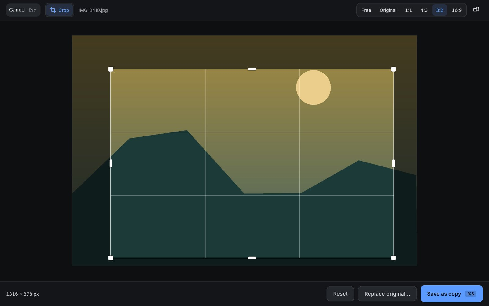

<p align="center">
  
</p>

<h1 align="center">Image Viewer</h1>

<p align="center">
  A fast, simple desktop image viewer built with <a href="https://tauri.app">Tauri 2</a>, Rust and React.
</p>

<p align="center">
  <a href="../../releases/latest"><b>Download the latest release</b></a>
  &nbsp;·&nbsp; Current version: 0.1.1 &nbsp;·&nbsp;
  <a href="CHANGELOG.md">Changelog</a>
</p>





## What's new in 0.1.1

**Crop.** Press <kbd>C</kbd> in the grid or viewer, or click the crop button, to open the editor.



- Drag the box to move it, drag its handles to resize it, or drag outside it to draw a new one. Arrow keys nudge it by 1 px (10 px with <kbd>Shift</kbd>).
- Aspect presets: Free, Original, 1:1, 4:3, 3:2 and 16:9, each in portrait or landscape.
- **Save as copy** (<kbd>⌘</kbd><kbd>S</kbd>) writes `photo (edited).jpg` next to the original. **Replace original** overwrites it after asking, and moves the original to the Trash so it can be restored.
- Camera data (EXIF), date taken and colour profiles are kept, and phone photos stored sideways are cropped the way you see them.
- Works with JPEG, PNG, WebP and BMP. Animated GIFs can't be edited.

The full list of changes is in the [changelog](CHANGELOG.md).

## Features

- **Open a folder, an image, or drop either onto the window.** Recent folders are one click away.
- **Thumbnail grid** with an adjustable tile size, filtering by name, and sorting by name, date or size. Thumbnails are generated in Rust and cached on disk, so large camera folders stay responsive.
- **Viewer** with zoom toward the cursor, drag to pan, fit / 100%, view-only rotation, a navigator mini-map when zoomed in, and a filmstrip of nearby images.
- **Info panel** with dimensions, file details and camera EXIF (camera, lens, focal length, aperture, shutter, ISO, date taken).
- **Crop** with a draggable box, aspect presets (free, original, 1:1, 4:3, 3:2, 16:9, portrait or landscape), and keyboard nudging. Save the result as a new copy or replace the original. Camera data (EXIF) and colour profiles are kept, and a replaced original goes to the Trash.
- **Safe delete:** Move to Trash with a 5-second Undo. Files are never deleted permanently.
- **Keyboard-first:** everything has a shortcut (press <kbd>?</kbd> in the app).
- Remembers window size, thumbnail size, sort order and recent folders.

Supported formats: JPEG, PNG, GIF, WebP, BMP.

## Download

Get the installer from the [Releases page](../../releases/latest).

| Platform | File | Notes |
|---|---|---|
| macOS (Apple Silicon, M1 or later) | `…_aarch64.dmg` | Signed and notarized. Open the `.dmg` and drag Image Viewer to Applications. |
| Windows 10 / 11 | `…_x64-setup.exe` or `.msi` | Not code-signed yet. If SmartScreen appears, click **More info → Run anyway**. |

Intel Macs aren't supported at the moment.

## Keyboard shortcuts

| Key | In the grid | In the viewer |
|---|---|---|
| <kbd>←</kbd> <kbd>→</kbd> <kbd>↑</kbd> <kbd>↓</kbd> | Move selection | Previous / next image |
| <kbd>↵</kbd> / <kbd>Space</kbd> | Open in viewer | Next image |
| <kbd>Esc</kbd> | Clear filter | Back to grid (or leave full screen) |
| <kbd>+</kbd> / <kbd>−</kbd> | Thumbnail size | Zoom in / out |
| <kbd>0</kbd> / <kbd>1</kbd> | | Fit / 100% |
| <kbd>C</kbd> | Crop | Crop |
| <kbd>R</kbd> | | Rotate (view only) |
| <kbd>I</kbd> | | Toggle info panel |
| <kbd>F</kbd> | | Full screen |
| <kbd>⌫</kbd> | Move to Trash | Move to Trash |
| <kbd>⌘</kbd><kbd>Z</kbd> | Undo trash | Undo trash |
| <kbd>⌘</kbd><kbd>F</kbd> | Filter by name | |
| <kbd>⌘</kbd><kbd>O</kbd> | Open folder | Open folder |
| <kbd>?</kbd> | Show shortcuts | Show shortcuts |

In the editor: drag the box or its handles (drag outside it to draw a new one), <kbd>←</kbd> <kbd>→</kbd> <kbd>↑</kbd> <kbd>↓</kbd> to nudge it (<kbd>Shift</kbd> for 10 px), <kbd>⌘</kbd><kbd>S</kbd> to save as a copy, <kbd>Esc</kbd> to cancel.

On Windows, use <kbd>Ctrl</kbd> instead of <kbd>⌘</kbd>.

## Development

### Prerequisites

- [Rust](https://rustup.rs) (stable)
- [Node.js](https://nodejs.org) LTS
- Platform tools from Tauri's [prerequisites guide](https://v2.tauri.app/start/prerequisites/): Xcode Command Line Tools on macOS; Microsoft C++ Build Tools and WebView2 on Windows

### Run

```bash
npm ci
npm run tauri dev
```

The first run compiles all Rust dependencies, which takes a few minutes. After that, frontend changes hot-reload and Rust changes trigger a quick rebuild.

### Test

```bash
cd src-tauri && cargo test
```

The Rust tests cover cropping, EXIF rotation, keeping metadata, file naming, and the copy / replace save paths.

### Build

```bash
npx tsc               # type-check first; the build fails on unused imports
npm run tauri build
```

The installers are written to `src-tauri/target/release/bundle/` (`macos/` and `dmg/` on macOS; `msi/` and `nsis/` on Windows).

To sign and notarize a macOS build locally, set these environment variables before building (keep them in a file outside the repository and `source` it):

```bash
export APPLE_SIGNING_IDENTITY="Developer ID Application: Your Name (TEAMID)"
export APPLE_ID="you@example.com"
export APPLE_PASSWORD="app-specific-password"
export APPLE_TEAM_ID="TEAMID"
```

Then check the result with `spctl -a -vvv "src-tauri/target/release/bundle/macos/Image Viewer.app"`. It should report `source=Notarized Developer ID`.

## How it works

```
React (webview)                                Rust (src-tauri)
───────────────                                ────────────────
invoke("open_path")      ── IPC ──▶  library.rs   scan folder, grant access
    ───────▶  Tauri asset protocol: full-size image
    ───────▶  thumbs.rs    decode → resize → disk cache
invoke("image_info")     ── IPC ──▶  info.rs      dimensions + EXIF
invoke("trash_image")    ── IPC ──▶  library.rs   move to OS Trash
invoke("apply_edits")    ── IPC ──▶  edit/        load → crop → save copy / replace
```

- **Images never go through IPC.** Full-size images load through Tauri's asset protocol, and thumbnails through a custom `thumb://` protocol, so the webview streams and decodes them natively.
- **Access is granted per folder.** The asset protocol's scope starts empty. Opening a folder adds it at runtime, and `thumb://` and every command check the same list (`AppState`), so the webview can only read folders the user opened.
- **Thumbnails** are decoded with the `image` crate, rotated according to EXIF orientation, resized to 560 px, and cached under the app's cache directory, keyed by path, size and modified time. A semaphore limits how many are decoded at once.
- **Undo for Trash** works by waiting: the file disappears from the list immediately, and is only moved to the Trash after the 5-second Undo window closes.
- **Editing** happens in Rust. The frontend only describes the edit as a list of operations, e.g. `[{ "type": "crop", "x": 120, "y": 80, "width": 1600, "height": 900 }]`, in the image's displayed pixel coordinates. Rust loads the original with its EXIF rotation applied, runs the operations, and re-encodes in the same format (JPEG at quality 92), keeping the colour profile and EXIF. The orientation flag is reset, because the pixels are already rotated. It always writes to a temporary file first. *Save as copy* then renames it to `name (edited).jpg`; *Replace* moves the original to the Trash and renames the temporary file into its place. Animated GIFs can't be edited, since saving would drop their frames.
- **Cache busting:** after a replace, the path is unchanged, so image URLs carry `?v=<modified>-<size>` to make the webview load the new pixels.

### Adding an edit tool

Edits are built as a pipeline, so a new tool (rotate, resize, brightness…) doesn't touch the editor itself:

1. **Rust:** add `src-tauri/src/edit/<tool>.rs` with a struct for its parameters and `impl Operation for <Tool>`, then add a variant to the `EditOp` enum in `edit/mod.rs` and its arm in `EditOp::operation`.
2. **TypeScript:** add the operation's type to `EditOp` in `src/edit/types.ts`.
3. **UI:** create `src/edit/tools/<tool>/` exporting `defineTool({ id, label, shortcut, icon, init, isNoop, toOps, Controls?, Overlay? })`, and add it to `src/edit/tools/index.ts`.

The editor then shows the tool's tab, controls and overlay, and includes its operations when saving. Tools run in registry order, so put geometry tools (crop, rotate) before tools that change pixel values.

### Project layout

```
src/                     React frontend
├─ App.tsx               app state, keyboard handling, open / trash / edit flow
├─ components/           Welcome, Library (grid), Viewer, InfoPanel, overlays, icons
├─ edit/                 editor
│  ├─ EditMode.tsx       editor shell: layout, tool tabs, save / replace
│  ├─ tool.ts            the EditTool interface every tool implements
│  ├─ types.ts           operation types shared with Rust
│  └─ tools/crop/        crop tool: state, box overlay, aspect controls, geometry
└─ lib/                  typed command wrappers (api.ts), preferences, hooks
src-tauri/
├─ src/
│  ├─ lib.rs             app setup: plugins, state, protocol, commands
│  ├─ library.rs         open_path, trash_image, folder scanning
│  ├─ thumbs.rs          thumb:// protocol and thumbnail cache
│  ├─ imaging.rs         shared loader: EXIF rotation, colour profile, EXIF
│  ├─ edit/              apply_edits: EditOp pipeline (mod.rs), crop.rs, output.rs (safe saving)
│  ├─ info.rs            image_info (dimensions, EXIF)
│  ├─ state.rs           allowed folders + thumbnail semaphore
│  └─ error.rs           AppError, serialized to the frontend
├─ capabilities/         frontend permissions
└─ tauri.conf.json       window, bundle and security config
.github/workflows/       release workflow
```

## Releasing

Releases are built by GitHub Actions (`.github/workflows/release.yml`) for macOS and Windows.

1. Bump `version` in `src-tauri/tauri.conf.json` and `package.json`, and commit.
2. Tag and push:
   ```bash
   git tag v0.2.0
   git push origin main v0.2.0
   ```
3. The workflow builds, signs and notarizes the macOS app, builds the Windows installers, and uploads everything to a **draft** release. Review it, then publish.

The workflow needs these repository secrets for macOS signing: `APPLE_CERTIFICATE`, `APPLE_CERTIFICATE_PASSWORD`, `APPLE_SIGNING_IDENTITY`, `APPLE_ID`, `APPLE_PASSWORD`, `APPLE_TEAM_ID`. It also needs **Settings → Actions → General → Workflow permissions** set to **Read and write**.

## Roadmap

- [ ] Watch the open folder and update the grid live (`notify` crate)
- [ ] Remember folder access across restarts, so recents show cover photos
- [ ] Code-sign the Windows installer
- [ ] More edit tools: rotate / flip, resize, brightness and contrast
- [ ] HEIC and RAW support

## License

Released under the [MIT License](LICENSE). Copyright © 2026 Avirup Basu.
